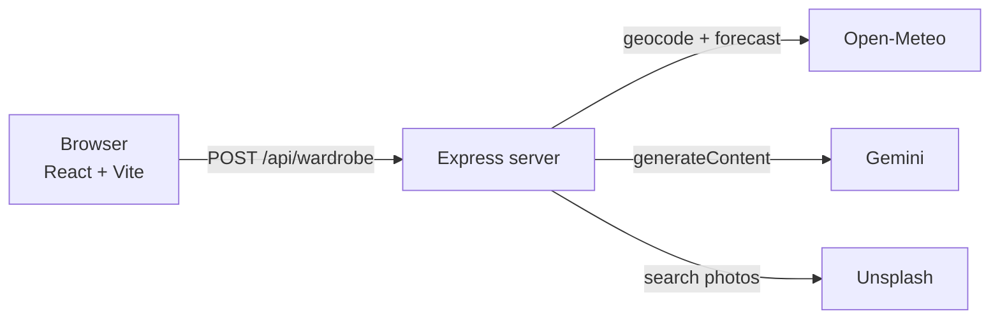
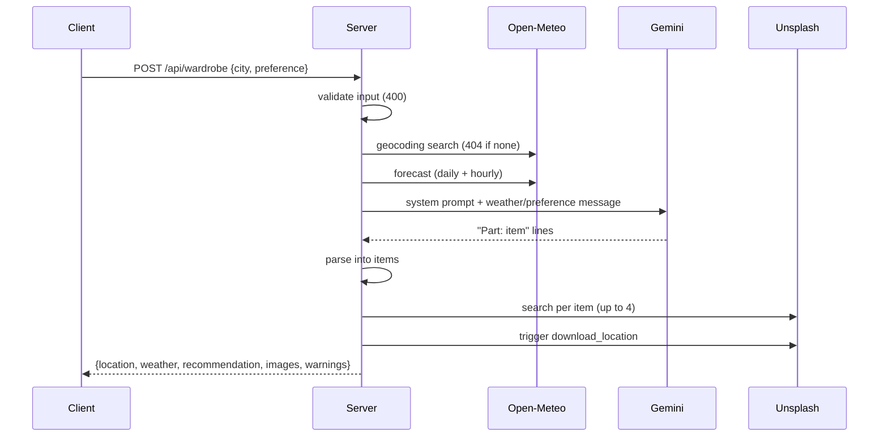

# Architecture

An npm-workspaces monorepo with a React client and an Express server. The server orchestrates three external services; the browser only talks to the server, so keys stay private.

## Request sequence

## Layout

| Path | Responsibility |
| --- | --- |
| `server/index.js` | App setup, `/api/health`, static serving, error handler |
| `server/config.js` | Loads root `.env`, exports config and `HttpError` |
| `server/routes/wardrobe.js` | `POST /api/wardrobe` orchestration |
| `server/services/weather.js` | Open-Meteo geocoding, forecast, WMO code labels |
| `server/services/gemini.js` | System prompt, user message, call, parsing |
| `server/services/images.js` | Unsplash search, attribution fields, download trigger |
| `client/src` | `App`, `api.js`, components `SearchForm`, `WeatherCard`, `Recommendation`, `ImageGrid` |

## Error handling

Errors are `HttpError(status, message, source)`. Input problems are 400, unknown city 404, upstream failures 502 (a missing server key is 500), each with a `source`. Image failures are non-fatal: the response still succeeds with `images: []` and a `warnings` entry.
